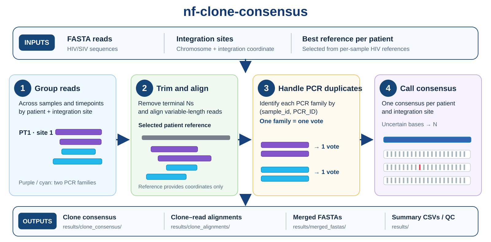

# nf-clone-consensus

A Nextflow pipeline for generating HIV/SIV clone consensus sequences from reads grouped by integration site. It uses reference-guided alignment of variable-length fragments and accounts for PCR duplicates.
This is a downstream pipeline that utilizes some of the outputs of the `nf-viral-integration pipeline` (https://github.com/connor122721/nf-viral-integration )

## Requirements

- Nextflow and Java (developed with Nextflow 25.10.4)
- Docker, Singularity, or Apptainer
- SLURM for HPC runs

Python and MAFFT are provided by the containers.

## Input

Provide a CSV with one row per sample:

```csv
sample_id,patient_id,timepoint,hiv_fasta_filepath,integration_site_filepath,best_hiv_ref_filepath
PT1-1,PT1,1,fastas/PT1-1.fa,sites/PT1-1.csv,references/refA.fa
PT1-2,PT1,2,fastas/PT1-2.fa,sites/PT1-2.csv,references/refB.fa
PT2-3,PT2,3,fastas/PT2-3.fa,sites/PT2-3.csv,references/refA.fa
```

Paths may be absolute or relative to the CSV location. The integration-site file must contain `READ`, `PCR_ID`, `chromosome`, and `INTEGRATION_SITE` (case-sensitive). A FASTA header must start with its matching `READ` identifier. See the [data dictionary](docs/data_dictionary.md) for definitions.

## Run

Choose one executor (`local` or `slurm`) and one container engine (`docker`, `singularity`, or `apptainer`) using `-profile`.

**Local example (Singularity):**

```bash
git clone https://github.com/ekankaka/nf-clone-consensus.git
cd nf-clone-consensus

nextflow run main.nf \
    -profile local,singularity \
    --input tests/data/annotation.csv \
    --outdir results_test
```

Use `-profile local,docker` or `-profile local,apptainer` for other container engines. Replace the input and output paths to run your data.

**HPC example (SLURM and Singularity):**

Create an external `hpc.config` for your cluster:

```groovy
// hpc.config — customize for your cluster
process {
    queue = 'compute'                        // SLURM partition where jobs run
    clusterOptions = '--account=my_project'   // Additional SLURM options, e.g., user account
}

singularity.autoMounts = true
```

```bash
export NXF_SINGULARITY_CACHEDIR=/shared/container-cache

nextflow run main.nf \
    -profile slurm,singularity \
    -c /path/to/hpc.config \
    --input /path/to/annotation.csv \
    --outdir /path/to/results \
    -w /shared/scratch/work \
    -resume
```

For Apptainer, use `-profile slurm,apptainer`. Replace the example partition, account, and paths with your cluster's settings. Work and cache directories must be accessible from compute nodes.

## Method



By default, each trimmed integrated read is checked for orientation against the selected patient reference; use `--check_orientation false` to disable this. Uncertain orientations are retained and flagged. The reference guides alignment but does not contribute consensus bases. Each `(sample_id, PCR_ID)` family contributes one vote per position. By default, multi-family calls require two informative families and at least 60% support; insufficiently supported bases are `N`. Single-read and single-family clones are retained with QC flags.

## Outputs

```text
results/
├── merged_fastas/<patient_id>_merged.fasta
├── clone_consensus/<patient_id>_consensus.fasta
├── clone_alignments/<consensus_header>_alignment.fasta
├── unintegrated_sequences/<patient_id>_unintegrated.fasta
├── patient_sequence_counts.csv
├── clone_summary.csv
├── patient_clone_statistics.csv
├── reference_selection.csv
└── review/
    ├── read_assignments.csv
    ├── unmatched_fasta_reads.csv
    ├── unused_integration_records.csv
    └── unmatched_fastas/
```

Each clone alignment is named after its consensus FASTA header and contains the aligned consensus followed by the terminal-N-trimmed input reads. Clone consensus headers have the form:

```text
>patient_id_chromosome_INTEGRATION_SITE_n_reads_n_unique_reads
```

Here, `n_reads` is the total number of contributing reads and `n_unique_reads` is the number of distinct PCR families. `clone_summary.csv` also contains each final `consensus_sequence`. See the [data dictionary](docs/data_dictionary.md) for every output field and QC flag.

## Limitations

Consensus sequences are computational summaries, not necessarily complete HIV/SIV genomes. Review low-coverage clones, ambiguous calls and indels using `clone_summary.csv` and `clone_alignments/`. Input FASTAs do not contain base-quality scores. Short or divergent reads may have uncertain orientation; references must be supplied in the intended genomic direction.

License: [MIT](LICENSE).
